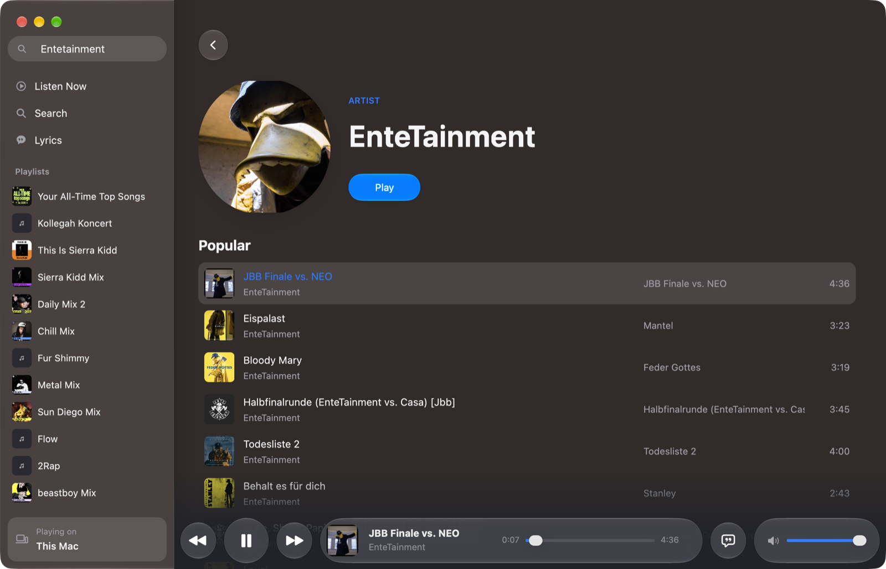

<p align="center">
  
</p>

<h1 align="center">OpenMusic</h1>

<p align="center">
  A native macOS player for Spotify, written in Rust.<br>
  One 13 MB app. No web view, no Electron, no librespot.
</p>

<p align="center">
  <a href="https://github.com/shkumbinhasani/openmusic/actions/workflows/ci.yml"></a>
  <a href="https://github.com/shkumbinhasani/openmusic/releases/latest"></a>
  
</p>

<p align="center">
  
</p>

OpenMusic signs in to your Spotify Premium account and joins it as a Spotify Connect device. It plays audio itself, so you can control it from Spotify on your phone, and it shows whatever your account plays on other devices. The interface uses the native macOS glass controls.

## Benchmarks

OpenMusic against the official Spotify app on the same Mac, measured with `scripts/bench.sh`.

| | OpenMusic | Spotify 1.3.10 | Difference |
|---|---:|---:|---:|
| App size | **13 MB** | 423 MB | 32× smaller |
| Launch to window | **220 ms** | 394 ms | 1.8× faster |
| Processes | **1** | 7 | |
| Memory, idle | **240 MB** | 2,054 MB | 8.6× less |
| Memory, playing | **266 MB** | 1,877 MB | 7.1× less |
| CPU, idle | **0.4%** | 3.0% | 7.5× less |
| CPU, playing | **4.0%** | 11.4% | 2.9× less |

<sub>MacBook Pro with Apple M4 Pro and 24 GB of memory, macOS 27.0, 23 November 2026. Launch time is the median of five launches, from <code>open</code> until the first window is on screen. Memory is the physical footprint of every process the app runs, added together; this is the figure Activity Monitor shows. CPU is the share of one core over 30 seconds. Each app was measured alone, signed in, 20 seconds after launch and again 20 seconds after it started playing the same album.</sub>

Run the benchmark yourself after building the app. It needs OpenMusic signed in, and Spotify installed if you want the comparison. It plays music in both apps for about a minute.

```sh
./scripts/bundle-macos.sh
./scripts/bench.sh
```

## Install

### Homebrew

```sh
brew install --cask shkumbinhasani/tap/openmusic
```

Installing by the full name also trusts this one cask, which Homebrew requires for third-party taps. `brew upgrade` installs new versions; the release workflow updates the tap each time a version is published. `brew uninstall --zap --cask openmusic` also removes the cache and the Keychain sign-in.

### Download

Download `OpenMusic-<version>-arm64.zip` for Apple silicon or `OpenMusic-<version>-x86_64.zip` for Intel from the [latest release](https://github.com/shkumbinhasani/openmusic/releases/latest), unzip it, and move OpenMusic to Applications.

### Gatekeeper

Releases are not notarized yet. The Homebrew cask removes the quarantine flag after installing, so OpenMusic opens straight away; that also skips the check macOS runs on a downloaded app's first launch. If you download the zip yourself, macOS blocks the first launch: open OpenMusic once, then go to **System Settings → Privacy & Security** and choose **Open Anyway**. Once releases are notarized, the release workflow drops that step from the cask and macOS checks the app as usual. See `docs/research/homebrew-updates.md` for the details.

### First launch

Choose **Sign in with Spotify** and approve the pairing in your browser with a Spotify Premium account. OpenMusic keeps the sign-in in your macOS Keychain. Choose **OpenMusic → Sign Out of Spotify** to remove it.

## What it does

- **Spotify Connect.** OpenMusic appears as a device named “OpenMusic”. Pick it from any Spotify app, or choose **Play on This Mac** to move playback from another device.
- **Home.** Spotify’s Home feed: shortcuts, your mixes, recently played and recommendations, with Music and Podcasts filters. Every card has a play button on hover.
- **Search.** Songs, artists, albums, playlists, podcasts and profiles, with suggestions as you type and your recent searches. Browse all opens Spotify’s genres and moods. Paste any Spotify link or URI to open it. Command-F focuses the search field. If Spotify’s search service fails, songs still come back.
- **Playlists, albums and artists.** Your playlists sit in the sidebar. Artist pages show the portrait, popular songs, the discography by albums, singles and compilations, the biography and artists fans also like, with Follow and Play. Playing a song from a playlist or album queues the rest, as Spotify does.
- **Lyrics.** Time-synced lyrics highlight and scroll with the song. Click a line to jump to it.
- **Native controls.** On macOS 26 and later the playback buttons, now-playing bar and volume are AppKit glass controls placed over the GPUI content, so songs scroll underneath them. Older systems get plain controls, without seeking and volume.

Podcasts and offline downloads are not supported.

## Build from source

Install Rust and Xcode. GPUI compiles Metal shaders during the build, so Xcode’s Metal Toolchain must be installed:

```sh
xcodebuild -downloadComponent MetalToolchain
cargo run --locked
```

`./scripts/bundle-macos.sh` builds an optimized `target/OpenMusic.app`. Set `TARGET=x86_64-apple-darwin` to build for Intel. The script signs with your Apple Development or Developer ID identity when one is in your keychain, which keeps the Keychain approval across rebuilds.

## Releases

Pushes and pull requests run `.github/workflows/ci.yml`: formatting, Clippy, tests and a bundle build.

To publish a version, set `version` in `Cargo.toml`, commit, then push a matching tag:

```sh
git tag v0.2.0
git push origin v0.2.0
```

`.github/workflows/release.yml` then:

1. checks that the tag matches `Cargo.toml`;
2. builds `OpenMusic.app` for Apple silicon and Intel;
3. signs it with the certificate in `MACOS_CERTIFICATE`, and notarizes it when that is a Developer ID;
4. publishes both zips and a `SHA256SUMS` file as a GitHub release;
5. writes the new version and checksums into the Homebrew tap.

| Secret | Purpose |
|---|---|
| `MACOS_CERTIFICATE` | Developer ID Application certificate and key, as a base64 `.p12`. An Apple Development certificate works until you have one, but those builds are not notarized |
| `MACOS_CERTIFICATE_PASSWORD` | Password for that `.p12` |
| `APPLE_API_KEY` | App Store Connect API key for notarization, as a base64 `.p8` |
| `APPLE_API_KEY_ID` | ID of that key |
| `APPLE_API_ISSUER` | Issuer ID of that key |
| `TAP_DEPLOY_KEY` | Private half of a deploy key with write access to the tap repository |

Without a certificate the workflow still publishes, but signs ad hoc. macOS then treats each version as a new app, so the Keychain asks again for access to the sign-in after every upgrade. Without the deploy key it skips the Homebrew step. The cask goes to `Casks/openmusic.rb` in `<owner>/homebrew-tap`, next to your other casks; set the `HOMEBREW_TAP` repository variable to use another tap. The cask template is `packaging/homebrew/openmusic.rb`; the workflow fills in the version and checksums, and drops the quarantine step when the build is notarized.

## How playback works

OpenMusic registers with Spotify the way Spotify’s Web Playback SDK does, then plays audio natively:

1. Sign-in uses Spotify’s OAuth device flow (`oauth.rs`).
2. A websocket to Spotify’s dealer service delivers commands (`dealer.rs`).
3. OpenMusic registers a track-playback device and follows the state machine Spotify sends, reporting playback state back (`engine/`).
4. Audio is Spotify’s FairPlay-protected AAC. OpenMusic builds an HLS playlist from the file’s segment table and plays it with AVFoundation. macOS FairPlay decrypts it with a license from Spotify, so the content protection stays intact (`player.rs`).
5. Metadata, search, stations, liked songs and lyrics come from Spotify’s internal API (`catalog.rs`). Other devices are mirrored through a Connect observer (`connect.rs`).

The protobuf schemas in `crates/spotify-proto/proto` were extracted from the Spotify macOS app; see `docs/research/proto-extraction.md`. The rest of the protocol research is in `docs/research/`.

## Disclaimer

OpenMusic is not affiliated with or endorsed by Spotify. It uses Spotify’s private interfaces, which is likely outside Spotify’s developer terms, and Spotify can change those interfaces at any time.
